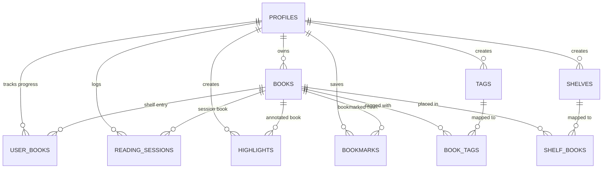

# PageTurn 📖

PageTurn is a modern, offline-first personal EPUB e-reader, library manager, and reading habit tracker. Engineered with a physical book tactile philosophy and a minimalist **Obsidian & Electric Signal** aesthetic inspired by Nothing OS and Apple typography, PageTurn delivers a distraction-free, app-like reading experience straight to the browser.

---

## 🛠 Tech Stack

| Layer | Technologies |
|---|---|
| **Framework** | [Next.js 16.3 (App Router)](https://nextjs.org/) & [React 19.2](https://react.dev/) |
| **Language & Tooling** | [TypeScript 5](https://www.typescriptlang.org/), [ESLint 9](https://eslint.org/), Webpack build pipeline |
| **Styling & UI** | [Tailwind CSS v4](https://tailwindcss.com/), [Lucide React](https://lucide.dev/), Custom Design Tokens |
| **Typography** | `Space Grotesk` (Display), `DM Sans` (Body), `DM Mono` (Telemetry/Data), `Source Serif 4` & `OpenDyslexic` (Reader) |
| **Database & Auth** | [Supabase](https://supabase.com/) (PostgreSQL, Row Level Security, Storage Buckets, Realtime WebSockets, OAuth) |
| **EPUB Engine** | [epub.js](http://epubjs.org/) & [JSZip](https://stuk.github.io/jszip/) |
| **PWA & Offline** | [@serwist/next](https://github.com/serwist/serwist) (Service Workers) & [localforage](https://localforage.github.io/localForage/) (IndexedDB LRU Cache) |
| **Data Visualization** | [Recharts 3](https://recharts.org/) & [date-fns 4](https://date-fns.org/) |
| **Image Processing** | [browser-image-compression](https://github.com/Donaldcwl/browser-image-compression) |
| **Testing** | [Playwright](https://playwright.dev/) |

---

## ✨ Features Overview

### 1. 📖 Tactile EPUB Reader Engine
- **Physical Book Canvas**: Centered document stage with realistic paper deckle edge, spine crease ambient shading, and smooth 3D page curl flip transitions (`page-turn-flip-next` / `page-turn-flip-prev`).
- **Reading Themes**: Instant toggle between 3 paper canvas surfaces:
  - **Clean Light** (`#ffffff` paper with deep ink text)
  - **Warm Sepia Paper** (`#f4ecd8` aged paper with warm brown ink)
  - **Obsidian Dark** (`#111413` low-emission dark mode)
- **Fluid Typography**: Dynamic type scaling (60% to 200%), font family switching (`Serif`, `Sans-Serif`, `OpenDyslexic`), and standardized publisher CSS overrides.
- **Reading Modes**: Traditional paginated reader with side-click/arrow-key turns, plus continuous vertical scroll flow.
- **Desktop Flip Controls**: Ambient floating side arrow navigation buttons (`←` / `→`) and tap-to-reveal HUD.

### 2. 🔍 In-Book Search & Text-to-Speech (TTS)
- **Full-Text Chapter Search**: Real-time keyword scanning across all EPUB sections with highlighted excerpt previews and direct CFI navigation.
- **Text-to-Speech (TTS / Read Aloud)**: Web Speech Synthesis API integration that streams current chapter paragraphs aloud with audio playback status indicators.
- **Distraction-Free "Zen Mode"**: Pure reading immersion mode hiding all toolbars and navigation chrome, toggled instantly via `F` or `Esc`.

### 3. 🖍️ Annotations, Bookmarks & Instant Dictionary
- **Multi-Color Highlighting**: Highlight text in 5 distinct colors (Yellow, Green, Blue, Pink, Purple) with exact CFI range tracking and inline annotation notes.
- **Bookmark Management**: One-click bookmarking of current reading positions with timestamped index navigation and deletion.
- **Multi-Tab Sidebar Drawer**: Slide-out drawer with dedicated segmented tabs for **Table of Contents (TOC)**, **Bookmarks**, **Highlights & Notes**, and **Search**.
- **Instant Dictionary Popover**: Double-click or select any word for inline phonetic transcriptions, part-of-speech tags, definitions, and usage examples via DictionaryAPI with in-memory caching.

### 4. ⚡ Spotlight Command Palette (`Cmd+K` / `Ctrl+K`)
- **Global Action Launcher**: Keyboard-driven command center accessible from anywhere in the application.
- **Instant Book Search**: Search your library and jump directly into any book without navigating to the library page.
- **Quick Page Navigation**: Jump to Shelf (`G S`), Library (`G L`), Stats (`G T`), History (`G H`), or Settings (`G ,`).
- **Contextual Reader Actions**: Switch canvas themes, toggle Read Aloud (`T`), toggle Bookmarks (`B`), open Table of Contents (`M`), toggle Zen Mode (`F`), or import new EPUBs (`U`).

### 5. 📚 Library & Shelf Organization
- **Dynamic Shelf Dashboard**:
  - Hero spotlight card for the currently reading book with cover art, progress ring, last-read relative timestamp (`formatRelativeTime`), and quick continue button.
  - Telemetry stats strip: Total Books, Actively Reading, and Finished counts.
  - "Jump Back In" carousel for recently opened books.
- **Library Management**:
  - Toggle between responsive **Grid** and **List** view modes.
  - Filter by reading state: `All`, `Reading`, `Want to Read` (`plan_to_read`), and `Finished` (`completed`).
  - Real-time search filter (title and author) and sorting (`Recently Read`, `Title`, `Progress`).
  - **Custom Shelves & Collections**: Create custom bookshelves and organize books into collections.
  - **Color-Coded Tags**: Create custom tags with unique hex colors and attach multiple tags per book.
  - **Metadata Editor**: Edit book title, author, description, and cover image URL in-app.
  - **Cascading Book Deletion**: Safe removal that cascades across all database relations and purges both Supabase Storage objects (`epubs` & `covers`) and IndexedDB local caches.

### 6. 📊 Reading Analytics, Streaks & Habit Tracking
- **Automatic Session Tracking**: Reading sessions over 30 seconds are logged automatically with start/end timestamps, duration, chapter name, and calculated words read.
- **Streak Contribution Heatmap**: GitHub-style 20-week calendar heatmap visualizing daily reading consistency with intensity shading and tooltips.
- **Daily Reading Goals**: User-configurable daily goal target in minutes (stored in user profile) with animated SVG progress rings.
- **Velocity Metrics**: Total reading time, lifetime books completed, total words read, and average reading speed (WPM).
- **Interactive Recharts Visualizations**:
  - **Daily Reading Time**: Bar chart with configurable date filters (`Last 30 Days`, `Last 90 Days`, `This Year`, `All Time`).
  - **Reading Velocity**: Line chart tracking daily word output.
- **Full Data Portability**: One-click JSON data export (`pageturn-export-YYYY-MM-DD.json`) bundling all profiles, books, sessions, bookmarks, highlights, tags, and shelves.

### 7. ☁️ Offline-First Architecture & Realtime Sync
- **Local EPUB Caching**: EPUB files are cached as ArrayBuffers in IndexedDB via `localforage` (`epub_cache`) using an **LRU (Least Recently Used) eviction policy** (capped at 10 cached books).
- **Background Offline Queue**: Offline mutations (progress syncs, session logs, bookmarks, highlights) are queued in IndexedDB (`offline_queue`) and automatically flushed with retry backoff when network connectivity is restored (`window.online`).
- **Cross-Device Realtime Progress Sync**: Uses Supabase Realtime WebSocket channels (`sync_${bookId}`) to monitor remote reading progress changes. When reading on another device, an ambient notification prompts the user to jump to the newest position.
- **PWA Ready**: Registered Service Worker via Serwist with runtime caching and manifest metadata.

---

## 📂 Project Architecture

```
PageTurn/
├── public/                     # Static assets, PWA icons, dev sample book, service worker
│   ├── dev-book.epub           # Local test EPUB
│   └── sw.js                   # Serwist-generated service worker
│
├── src/
│   ├── app/                    # Next.js 16 App Router
│   │   ├── (authenticated)/    # Protected app routes wrapped in AppShell
│   │   │   ├── history/        # Reading session log, streak heatmap, daily goal ring
│   │   │   ├── library/        # Grid/list library, tag & shelf filters, metadata editor
│   │   │   ├── read/[bookId]/  # EPUB loader, cache resolver, reader mount
│   │   │   ├── settings/       # Profile daily goals, account info, full JSON export
│   │   │   ├── shelf/          # Dashboard with hero spotlight, recent reads, quick stats
│   │   │   └── stats/          # Reading velocity charts, WPM, reading time analytics
│   │   │
│   │   ├── actions/            # Next.js Server Actions
│   │   │   ├── library.actions.ts # Book metadata, status, tags, shelves, cascading delete
│   │   │   ├── reader.actions.ts  # Progress syncing, sessions, bookmarks, highlights
│   │   │   └── stats.actions.ts   # Stats aggregation, streaks, full JSON user export
│   │   │
│   │   ├── auth/callback/      # OAuth callback handler
│   │   ├── dev-login/          # Local development quick sign-in route
│   │   ├── dev-reader/         # Standalone reader harness for rendering tests
│   │   ├── globals.css         # Tailwind v4 theme, 3D book canvas, card tilt, animations
│   │   ├── layout.tsx          # Root layout & font definitions
│   │   ├── manifest.ts         # PWA Web App Manifest
│   │   ├── page.tsx            # Landing page with interactive book stage & feature showcase
│   │   └── sw.ts               # Serwist service worker worker definition
│   │
│   ├── components/
│   │   ├── books/              # BookCard (3D perspective tilt), ProgressRing
│   │   ├── history/            # StreakHeatmap, DailyGoalRing
│   │   ├── layout/             # AppShell, TopNav, BottomNav (mobile)
│   │   ├── library/            # ShelvesSidebar, ManageTagsDialog, ManageCollectionsDialog, EditMetadataDialog
│   │   ├── reader/             # EpubReader, ReaderToolbar, HighlightPopover, DictionaryPopover
│   │   ├── ui/                 # CommandPalette (Cmd+K), ToastContainer
│   │   └── upload/             # BookUploader (drag-and-drop, DRM validation, cover compression)
│   │
│   ├── lib/
│   │   ├── supabase/           # Browser client, server client, requireUser auth helper
│   │   ├── app-events.ts       # Global event bus for Command Palette & Uploader modals
│   │   ├── design-tokens.ts    # Monochromatic Obsidian, Paper & Signal Lime design tokens
│   │   ├── dictionary.ts       # DictionaryAPI lookup client with memory cache
│   │   ├── epub-cache.ts       # IndexedDB EPUB cache with LRU eviction
│   │   ├── epub-utils.ts       # Client-side metadata & cover extraction via epub.js/JSZip
│   │   ├── offline-queue.ts    # Offline mutation queue with auto-reconnection flush
│   │   ├── reader-settings.ts  # LocalStorage reader preferences manager
│   │   ├── toast.ts            # Reactive toast notification event emitter
│   │   └── upload-book.ts      # Multi-stage EPUB & cover upload with retry backoff
│   │
│   └── types/                  # Type definitions (epub.d.ts)
│
└── supabase/
    ├── functions/              # Supabase Edge Functions
    │   └── streak-reminders/   # Deno function for automated reading streak emails
    ├── migrations/             # Incremental migration files
    │   ├── 20260811151900_add_highlight_text.sql # Highlight text snippet column
    │   └── 20260811153000_analytics_wpm.sql      # Reading session words_read column
    ├── migration.sql           # Base schema: profiles, books, user_books, reading_sessions, RLS
    ├── phase1.sql              # Highlights, bookmarks, and Realtime publication
    ├── phase2.sql              # Performance composite indexes
    └── phase3.sql              # Tags, shelves, book_tags, shelf_books mapping
```

---

## 🗄 Database Schema (Supabase)

PageTurn enforces strict multi-tenant isolation using PostgreSQL **Row Level Security (RLS)**.



### Core Tables
- **`profiles`**: Extends `auth.users`. Stores `daily_goal_minutes` (default 60) and profile timestamps.
- **`books`**: Global book catalogue records storing `user_id`, `title`, `author`, `description`, `cover_url`, and private `epub_path`.
- **`user_books`**: User-specific reading state (the "Shelf"). Stores `status` (`plan_to_read`, `reading`, `completed`), `current_cfi`, `progress_percentage`, `last_read_at`, and `completed_at`.
- **`reading_sessions`**: Analytic logs storing `session_date`, `start_time`, `end_time`, `duration_minutes`, `chapter_name`, and `words_read` (for WPM calculations).

### Annotations & Notes
- **`highlights`**: Text highlights with `cfi_range`, `color`, `text` (snippet excerpt), and optional `note`.
- **`bookmarks`**: User points of interest with exact `cfi` coordinates and `label`.

### Organization & Collections
- **`tags` & `book_tags`**: User-defined tag names with custom color codes mapped many-to-many to books.
- **`shelves` & `shelf_books`**: User-defined collection shelves mapped many-to-many to books.

### Storage Buckets
- **`epubs`** (*Private*): Stores raw `.epub` files under `{user_id}/{book_id}.epub`. Requires authenticated access.
- **`covers`** (*Public*): Stores compressed JPEG covers (`<= 600px`, `<= 200KB`) under `{user_id}/{book_id}-cover.jpg`.

---

## ⌨️ Keyboard Shortcuts

| Shortcut | Context | Action |
|---|---|---|
| <kbd>Cmd</kbd> + <kbd>K</kbd> / <kbd>Ctrl</kbd> + <kbd>K</kbd> | Global | Open / Close Command Palette |
| <kbd>G</kbd> then <kbd>S</kbd> | Command Palette | Navigate to Shelf |
| <kbd>G</kbd> then <kbd>L</kbd> | Command Palette | Navigate to Library |
| <kbd>G</kbd> then <kbd>T</kbd> | Command Palette | Navigate to Reading Stats |
| <kbd>G</kbd> then <kbd>H</kbd> | Command Palette | Navigate to Reading History |
| <kbd>G</kbd> then <kbd>,</kbd> | Command Palette | Navigate to Settings |
| <kbd>U</kbd> | Command Palette | Open EPUB Import Modal |
| <kbd>←</kbd> / <kbd>→</kbd> | Reader | Turn to Previous / Next Page |
| <kbd>F</kbd> or <kbd>Esc</kbd> | Reader | Toggle Zen / Distraction-Free Mode |
| <kbd>B</kbd> | Reader | Toggle Bookmark for Current Page |
| <kbd>T</kbd> | Reader | Toggle Text-to-Speech (Read Aloud) |
| <kbd>M</kbd> | Reader | Toggle Table of Contents & Sidebar |

---

## 🚀 Local Development Setup

### 1. Prerequisites
- **Node.js**: v20 or higher
- **npm** or **pnpm**
- A **Supabase project** (cloud or local Supabase CLI)

### 2. Clone and Install Dependencies
```bash
git clone https://github.com/theprachurya/PageTurn.git
cd PageTurn
npm install
```

### 3. Environment Variables
Create `.env.local` in the project root:
```env
NEXT_PUBLIC_SUPABASE_URL="https://your-project.supabase.co"
NEXT_PUBLIC_SUPABASE_ANON_KEY="your-anon-key"
```

### 4. Supabase Database Migrations
Execute the SQL scripts in your Supabase SQL Editor in the following order:
1. `supabase/migration.sql` (Creates base schema, enums, tables, RLS policies, and storage buckets)
2. `supabase/phase1.sql` (Adds `highlights`, `bookmarks`, and enables Realtime publication on `user_books`)
3. `supabase/phase2.sql` (Adds composite performance indexes)
4. `supabase/phase3.sql` (Adds `tags`, `shelves`, and association mapping tables)
5. `supabase/migrations/20260811151900_add_highlight_text.sql` (Adds `text` snippet column to `highlights`)
6. `supabase/migrations/20260811153000_analytics_wpm.sql` (Adds `words_read` column to `reading_sessions`)

Verify that the `epubs` (private) and `covers` (public) storage buckets are visible in your Supabase Dashboard under **Storage**.

### 5. Run Development Server
```bash
npm run dev
```
Open [http://localhost:3000](http://localhost:3000) in your browser.

> [!TIP]
> For quick local testing without setting up Google OAuth, visit `/dev-login` to sign in automatically with test credentials (`test@example.com`), or `/dev-reader` to test the EPUB rendering harness directly with a sample book.

### 6. Linting & Testing
```bash
# Run ESLint
npm run lint

# Build production bundle (with Serwist Service Worker)
npm run build
```

---

## 📄 License

This project is licensed under the MIT License.
